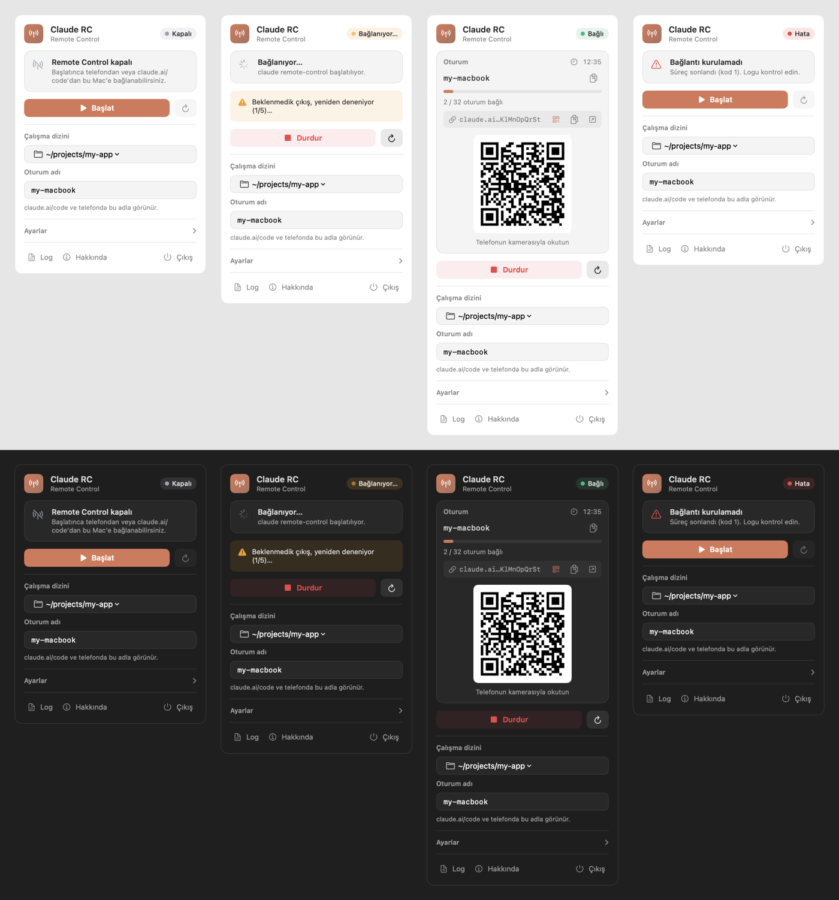

# Claude RC

macOS menü çubuğu uygulaması. `claude remote-control` sürecini saatin yanından
başlatır/durdurur, durumunu gösterir ve Mac her açıldığında kendini geri
başlatabilir.



## Kurulum

Gereken: macOS 13+ (Apple Silicon veya Intel) ve kurulu, giriş yapılmış
[`claude` CLI](https://docs.anthropic.com/en/docs/claude-code).

### Tek komut

```bash
curl -fsSL https://raw.githubusercontent.com/erenbekman/claude-rc-menubar/main/install.sh | bash
```

Son sürümü indirir, `/Applications`'a kurar (açıksa eskisini kapatıp
değiştirir) ve başlatır. Güncellemek için aynı komutu tekrar çalıştırın.
Başka bir klasöre kurmak için:
`curl -fsSL … | INSTALL_DIR=~/Applications bash`.

### Elle indirme

[Releases](https://github.com/erenbekman/claude-rc-menubar/releases/latest)
sayfasından `Claude-RC.zip`'i indirip açın, `Claude RC.app`'i Uygulamalar
klasörüne sürükleyin.

Uygulama Apple'a notarize ettirilmediği için tarayıcıyla indirilen kopyayı
macOS ilk açılışta engeller. **Sistem Ayarları › Gizlilik ve Güvenlik ›
Yine de Aç** deyin ya da karantina işaretini kaldırın:

```bash
xattr -dr com.apple.quarantine "/Applications/Claude RC.app"
```

### Kaynaktan derleme

```bash
./build.sh --install     # derler, /Applications'a kopyalar, başlatır
./build.sh               # sadece build/Claude RC.app ve build/Claude-RC.zip üretir
```

Ek olarak Xcode Command Line Tools (`swiftc`) gerekir. Çıktı universal'dır
(arm64 + x86_64).

### İlk açılış

- Menü çubuğunda anten simgesi çıkar; tıklayıp **Çalışma dizini** seçin.
- O dizinde daha önce `claude` çalıştırmadıysanız bir kez terminalden
  çalıştırıp workspace güven onayını verin.
- Bildirim izni sorulur; kopma ve hata uyarıları için izin verin.

## Menü çubuğu

| Simge | Anlamı |
|---|---|
| Anten (soluk) | Kapalı |
| Anten + `…` | Bağlanıyor |
| Anten (net) + sayı | Bağlı — sayı, aktif oturum adedi |
| Ünlem üçgeni | Hata (panelde nedeni yazar) |

Simgeye tıklayınca panel açılır; dışına tıklamak veya `Esc` kapatır.

## Panel

- **Durum rozeti** — Kapalı / Bağlanıyor (nabız atan nokta) / Bağlı / Hata.
- **Durum kartı** — bağlıyken sunucunun bildirdiği oturum adı (kopyala),
  açık kalma süresi, `N / 32` oturum doluluk çubuğu ve
  `claude.ai/code?environment=…` linki (kopyala / tarayıcıda aç). Kapalı,
  bağlanıyor ve hata durumlarında ne yapılacağını söyleyen kısa açıklama.
- **QR kod** — link satırındaki QR düğmesi, ortam linkini QR olarak gösterir;
  telefon kamerasıyla okutup doğrudan bağlanırsınız. Açık/kapalı tercihi
  hatırlanır.
- **Uyarı şeridi** — yeniden deneme veya aynı dizinde başka sunucu gibi
  uyarılar.
- **Başlat / Durdur** (⌘S), **Yeniden başlat** (⌘R)
- **Çalışma dizini** — son kullanılan 8 klasör + `Klasör Seç…`.
  RC açıkken dizin değişirse süreç otomatik yeniden başlar.
- **Oturum adı** — telefonda/claude.ai'de görünen sabit ad; panelde yerinde
  düzenlenir, Enter ya da **Kaydet** ile kaydedilir ve yazarken kaydedilecek
  slug gösterilir. Varsayılan: makine adının slug'ı. Boş bırakılırsa `--name`
  hiç geçilmez ve claude terminaldeki gibi rastgele ad üretir.
- **Ayarlar** (açılır bölüm, açık/kapalı durumu hatırlanır):
  - **Girişte otomatik başlat** — `~/Library/LaunchAgents/com.safepluspay.claude-rc.plist`
    yazıp `launchctl bootstrap gui/$UID` ile kaydeder. Mac her açılışta
    uygulamayı başlatır (uygulama da ayarlıysa RC'yi başlatır).
  - **Açılınca RC'yi başlat** — açılıştan 3 sn sonra (ağ hazır olsun diye).
  - **Mac boşta uyumasın** — IOKit güç iddiası; sadece RC çalışırken tutulur.
  - **Çökerse yeniden dene** — beklenmedik çıkışta artan gecikmeyle 5 deneme.
  - **Bildirimler** — bağlantı koptuğunda, yeniden bağlandığında, RC
    durduğunda (sesli) ve telefondan yeni oturum bağlandığında macOS
    bildirimi. Panel açıkken bildirim gönderilmez; bildirime tıklamak paneli
    açar. Sistem izni kapalıysa ayar satırı bunu söyler.
- **Log** (⌘L) — `~/Library/Logs/ClaudeRC.log`, **Hakkında**, **Çıkış** (⌘Q)

Panel SwiftUI ile, `NSPopover` içinde çizilir; açık/koyu temaya uyar. Renk ve
aralıklar küçük bir token setinden gelir: vurgu Claude turuncusu `#D97757`,
durumlar `#10B981` / `#F59E0B` / `#EF4444`, 4-8-12-16 pt boşluk ve 8/12 pt
köşe yarıçapı.

## Nasıl çalışıyor

Süreç şöyle başlatılır:

```
/bin/zsh -lc "cd <dizin> && exec <claude> remote-control --name <isim>"
```

- `-l` (login shell) `.zprofile`/`.zshrc`'yi okur — launchd'nin çıplak
  ortamında bile PATH (Homebrew, nvm) doğru olur.
- `exec` zsh'i claude ile değiştirir; sarmalayıcı süreç kalmaz, `terminate()`
  doğrudan claude'a gider.
- TTY gerekmez; çıktı bir pipe'tan okunur, ANSI temizlenir ve
  `Connected` / `Capacity: N/32` satırları panele yansıtılır.

## Oturum adı neden slug olmak zorunda

İlk sürüm `--name "Jane’s Mac mini"` geçiyordu (boşluk, büyük harf, kıvrık
kesme işareti U+2019). claude'un kendi ürettiği adlar ise katı slug:
`janes-mac-mini-2-local-virtual-aho` — yalnızca `[a-z0-9-]`. Bu ad telefondaki
listede beklenen biçimle eşleşmiyordu. Artık girilen her ad `slugify()` ile
bu biçime çevriliyor; kesme işareti **silinir**, ayırıcıya çevrilmez
(`Jane’s` → `janes`, `jane-s` değil).

TTY'nin bununla ilgisi yok — ölçüldü: pty'li ve pty'siz çalıştırma birebir
aynı sonucu veriyor. Tek fark `--name`'di.

## Öksüz süreç koruması

Uygulama zorla öldürülürse (pkill, çökme, oturum kapanması) macOS
`applicationWillTerminate`'i çalıştırmaz; başlatılan `claude rc` sahipsiz kalıp
sonsuza kadar yaşar ve telefonda hayalet ortam bırakır. İki önlem:

1. **Sinyal yakalama** — SIGTERM/SIGINT/SIGHUP yok sayılır, `DispatchSourceSignal`
   ile karşılanır, çocuk öldürülüp öyle çıkılır.
2. **PID dosyası** — `~/Library/Application Support/ClaudeRC/child.pid`.
   Açılışta kalıntı PID varsa ve gerçekten bir `claude remote-control` süreciyse
   (PID geri dönüşümüne karşı `ps` ile doğrulanır) kapatılır.

Ayrıca aynı dizinde başka sunucu varken panelden başlatılırsa uyarı çıkar ve
"Diğerlerini kapat, başlat" seçeneği sunulur. Temiz kapanan sunucu ortamını
korur ve yeniden başlarken **aynı environment'ı** kullanır; kirli ölen sunucu
ise her seferinde yeni bir ortam yaratır — session yığılmasının sebebi budur.

## Log neden şişmiyor

`claude rc` bir TUI: ekranı silip aynı 5-6 satırı **saniyede bir** yeniden
çizer. Ham dökülseydi log günde ~29 MB, ayda ~880 MB büyürdü. İki kademe var:

1. **Tekrar eleme** — son 16 satırda görülmüş bir satır diske hiç yazılmaz.
   Durum değişmediği sürece yazma olmaz (ölçüldü: 30 sn'de 0 bayt).
2. **Yazma anında kırpma** — dosya 512 KB'ı geçerse son 64 KB korunup gerisi
   atılır. Kontrol her yazmada yapılır, açılışta değil; uygulama aylarca açık
   kalsa da dosya tavanı geçemez.

Yazılan her satır `yyyy-MM-dd HH:mm:ss` damgası alır.

## Notlar

- Uygulamayı taşırsanız, açılışta giriş öğesi kaydı otomatik düzeltilir.
- Yeni bir dizinde ilk kez çalıştırmadan önce o dizinde bir kez `claude`
  çalıştırıp workspace güven onayını vermek gerekir.
- Uygulamadan **Çıkış** yapılırsa RC süreci de kapatılır.
- Bilgisayar tamamen kapalıyken telefondan iş yaptırmak isterseniz bu yetmez;
  o senaryo için cloud session (`claude --cloud`) gerekir.

## Dosyalar

```
Sources/ClaudeRC.swift   uygulama (süreç yönetimi + SwiftUI panel)
Sources/makeicon.swift   ikon üreteci
build.sh                 derleme (universal) + zip + yerel kurulum
install.sh               son release'i indirip kuran tek komutluk betik
docs/panel.png           panel ekran görüntüsü
```
